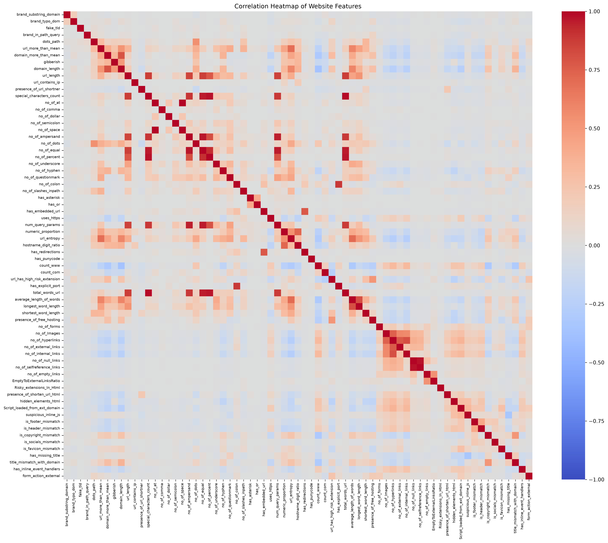
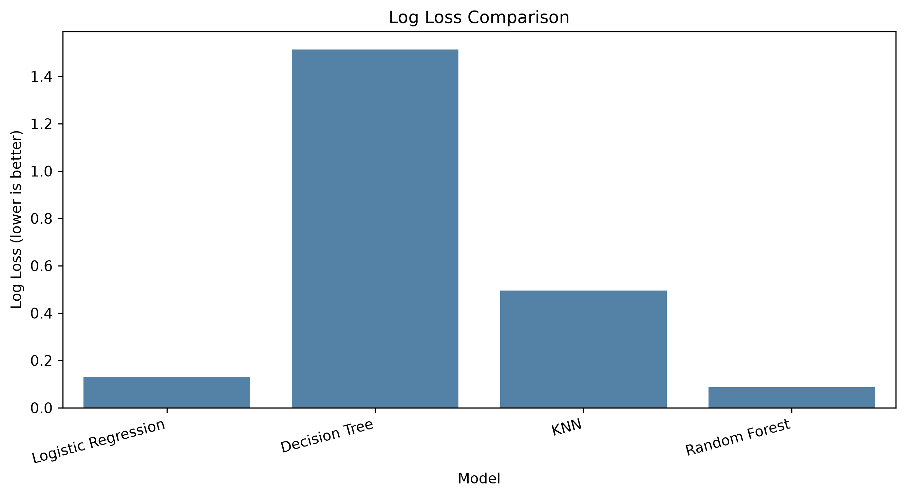
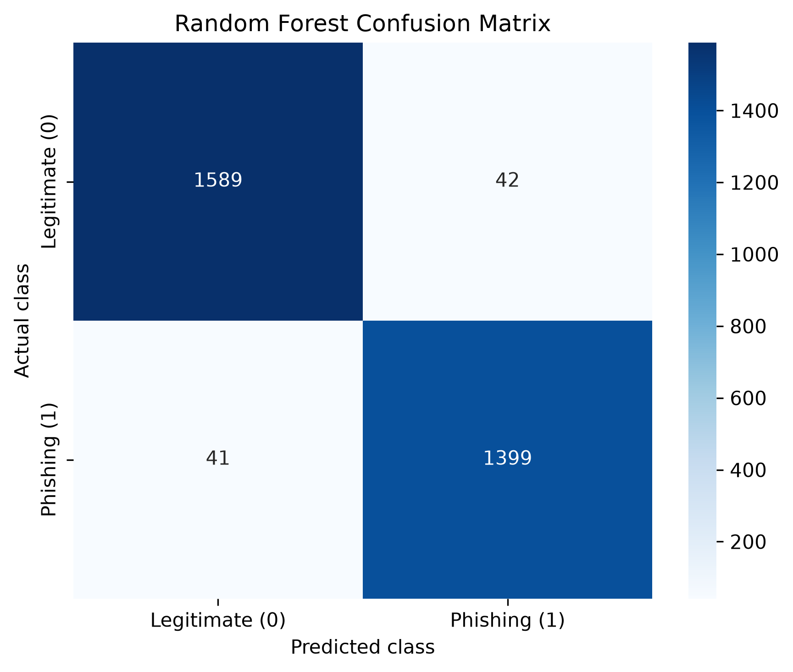

# CompPhish Phishing Website Detection

A supervised machine learning project that compares URL-derived, HTML-derived, and combined features for detecting phishing websites.

## Project question

How well do URL-derived, HTML-derived, and combined features distinguish phishing websites from legitimate websites in CompPhish? How do the results change when hostnames are kept separate between training and testing?

## Dataset

This project uses **CompPhish Version 3**. Its feature spreadsheet contains 15,358 samples, 70 features, and columns for URL, label, and serial number. Label `0` means legitimate; label `1` means phishing.

The version 3 Mendeley record describes phishing URLs from PhishTank and OpenPhish, legitimate URLs from the DataForSEO Top 1,000 list, and a collection period from September 2024 to August 2025. The associated paper describes a broader set of sources for legitimate sites. This source difference is noted as a limitation; the project uses the downloaded Version 3 files.

### Dataset audit

| Check | Result |
|---|---:|
| Original samples | 15,358 |
| Legitimate samples in original file | 8,154 |
| Phishing samples in original file | 7,204 |
| Missing values | 0 |
| Fully duplicated rows | 0 |
| Repeated URLs removed from the analysis copy | 7 |
| Samples after repeated-URL handling | 15,351 |
| Mapping URL or label mismatches | 0 |

The seven repeated URLs had the same label. The analysis kept one row per repeated URL and left the original spreadsheet unchanged. The cleaned analysis data contains 8,154 legitimate and 7,197 phishing samples.

### Features used

The data dictionary defines 47 URL-based and brand-jacking features and 23 HTML-derived features. The constant `brand_subdomain` feature was excluded. The features `url_more_than_mean` and `domain_more_than_mean` were also excluded because their dictionary definitions use mean lengths from phishing URLs and do not say that these thresholds were calculated from training data only.

| Feature group | Features in dataset | Features used |
|---|---:|---:|
| URL-based and brand-jacking | 47 | 44 |
| HTML-derived content | 23 | 23 |
| Combined | 70 | 67 |

The URL, label, serial number, and hostname are not model predictors. The hostname is used only for the grouped evaluation.

## Method

The main experiment uses an 80/20 stratified train/test split with `random_state=42`. All five classifiers use the same split and the same 67-feature input.

- **Logistic Regression:** scaled in a `Pipeline`; `max_iter=2000`
- **Decision Tree:** `random_state=42`
- **K-Nearest Neighbors:** scaled in a `Pipeline`; `n_neighbors=5`
- **Linear SVM:** scaled in a `Pipeline`; linear kernel
- **Random Forest:** 100 trees; `random_state=42`

Scaling is fitted on training data only for Logistic Regression, KNN, and SVM. Decision Tree and Random Forest use the unscaled numeric features.

Phishing, label `1`, is treated as the positive class. Metrics include accuracy, phishing precision, phishing recall, phishing F1, ROC-AUC, Log Loss where probabilities are available, and confusion matrices.

- **Accuracy:** fraction of all test samples classified correctly.
- **Precision:** fraction of predicted phishing sites that are phishing.
- **Recall:** fraction of actual phishing sites detected.
- **F1:** balance between phishing precision and recall.
- **ROC-AUC:** how well the model ranks phishing above legitimate samples across thresholds.
- **Log Loss:** evaluates the model’s probability estimates; lower is better.

## Classifier results

| Model | Accuracy | Phishing precision | Phishing recall | Phishing F1 | ROC-AUC | Log Loss |
|---|---:|---:|---:|---:|---:|---:|
| Logistic Regression | 0.9525 | 0.9468 | 0.9521 | 0.9494 | 0.9896 | 0.1293 |
| Decision Tree | 0.9580 | 0.9536 | 0.9569 | 0.9553 | 0.9579 | 1.5141 |
| KNN | 0.9577 | 0.9600 | 0.9493 | 0.9546 | 0.9837 | 0.4956 |
| Linear SVM | 0.9538 | 0.9482 | 0.9535 | 0.9508 | 0.9893 | N/A* |
| Random Forest | 0.9730 | 0.9709 | 0.9715 | 0.9712 | 0.9959 | 0.0867 |

\*Log Loss is not reported for the Linear SVM because this SVM setup returns decision scores rather than probabilities. The model’s other evaluation metrics are reported.

Random Forest had the highest phishing F1 and ROC-AUC, and the lowest Log Loss among models with probability outputs on this test split. Its confusion matrix contained 41 missed phishing samples and 42 legitimate samples incorrectly flagged.

## URL-only, HTML-only, and combined features

Random Forest was evaluated on the same training and test rows for each feature set.

| Feature set | Features | Accuracy | Phishing precision | Phishing recall | Phishing F1 | ROC-AUC | False negatives | False positives |
|---|---:|---:|---:|---:|---:|---:|---:|---:|
| URL-only | 44 | 0.9525 | 0.9456 | 0.9535 | 0.9495 | 0.9878 | 67 | 79 |
| HTML-only | 23 | 0.9319 | 0.9509 | 0.9014 | 0.9255 | 0.9823 | 142 | 67 |
| Combined | 67 | 0.9730 | 0.9709 | 0.9715 | 0.9712 | 0.9959 | 41 | 42 |

The combined feature set performed best overall on this split. URL-only features outperformed HTML-only features on accuracy, recall, and F1. HTML-only features had slightly higher precision than URL-only features but missed more phishing samples.

## EDA and statistical analysis

After repeated-URL handling, legitimate websites made up about 53.1% of the data and phishing websites about 46.9%.

The median URL length was 24 characters for legitimate sites and 42 for phishing sites. The mean lengths were 29.35 and 52.19 characters, respectively. One legitimate URL had a length of 6,310 characters; its recorded length matched the URL string, so it was retained.

For HTML forms, the median count was 1 for legitimate websites and 0 for phishing websites. One legitimate sample had 200 forms. These comparisons show why an individual feature should not be treated as a complete phishing detector.

Welch’s independent-samples t-test compared mean URL length between classes. It returned a t-statistic of 22.05 and a p-value of approximately `6.80 × 10⁻¹⁰⁶`. This indicates a difference in mean URL length in this dataset; it does not show that URL length alone can classify websites.

## Feature importance

Permutation importance measured the change in phishing F1 when one feature was shuffled. The top five features were:

| Feature | Mean decrease in phishing F1 |
|---|---:|
| `shortest_word_length` | 0.011390 |
| `count_www` | 0.009027 |
| `no_of_hyperlinks` | 0.008007 |
| `no_of_internal_links` | 0.006998 |
| `domain_length` | 0.005764 |

Importance describes how the Random Forest used features on this test set. It does not show that a feature causes phishing, and correlated features can share importance.

## False-negative analysis

The Random Forest missed 41 phishing samples on the main test split. Selected medians for all phishing test samples and missed phishing samples were:

| Feature | All phishing test samples | Missed phishing samples |
|---|---:|---:|
| `count_www` | 0 | 0 |
| `shortest_word_length` | 1 | 0 |
| `url_length` | 43 | 26 |
| `no_of_hyperlinks` | 5 | 59 |
| `no_of_external_links` | 2 | 8 |

These are descriptive differences, not proof of why any individual website was misclassified.

## Hostname-based evaluation

A second evaluation kept each normalized hostname in either the training set or the test set. The split had no shared normalized hostnames. A Random Forest was trained on 12,281 samples and tested on 3,070 samples.

| Metric | Result |
|---|---:|
| Accuracy | 0.9687 |
| Phishing precision | 0.9647 |
| Phishing recall | 0.9687 |
| Phishing F1 | 0.9667 |
| ROC-AUC | 0.9944 |
| False negatives | 45 |
| False positives | 51 |
| Shared normalized hostnames | 0 |

This is an exact-hostname separation check. Different subdomains of the same registered domain may still be treated as separate hostnames. This grouped test set also differs from the random test set, so score differences cannot be attributed to hostname grouping alone.

## Visualizations

These images are embedded from the repository’s `reports/figures` folder.

### Correlation heatmaps




### Classifier comparison and ROC curves


### Log Loss comparison



### Individual confusion matrices




### Decision Tree and Random Forest


### Feature group comparison


## Limitations

- The dataset represents a defined collection period, not all future phishing attacks.
- Phishing and legitimate samples were collected from different sources, which may create source-specific patterns.
- The random split can place related hosts in both sets. The hostname-based split avoids exact normalized hostname overlap but does not group all subdomains under their registered domain.
- The hostname-based evaluation uses one grouped holdout fold, not repeated cross-validation.
- HTML-derived features describe archived page snapshots; website content may change or disappear.
- Strong test results on CompPhish do not guarantee the same results on other datasets or live websites.

## Run the project

1. Download these Version 3 files from the [CompPhish Mendeley record](https://data.mendeley.com/datasets/fmbs4kp9wz/3):
   - `All_Features_threshold90.xlsx`
   - `Mapping_File.xlsx`
   - `Data_Dictionary.xlsx`
2. Place them in the project’s `data` folder. The data files are not committed to GitHub.
3. From PowerShell in the project folder, install the requirements and start Jupyter:

   ```powershell
   .\.venv\Scripts\python.exe -m pip install -r requirements.txt
   .\.venv\Scripts\python.exe -m notebook

4. Open notebooks/phishing_detection.ipynb and run the cells from top to bottom.
## References
- Goenka, R. (2026). CompPhish, Version 3 [Data set]. Mendeley Data. https://doi.org/10.17632/fmbs4kp9wz.3
- Goenka, R., Chawla, M., & Tiwari, N. (2026). CompPhish: A comprehensive dataset for diversified phishing detection. Data in Brief, 69, 113219. https://doi.org/10.1016/j.dib.2026.113219
