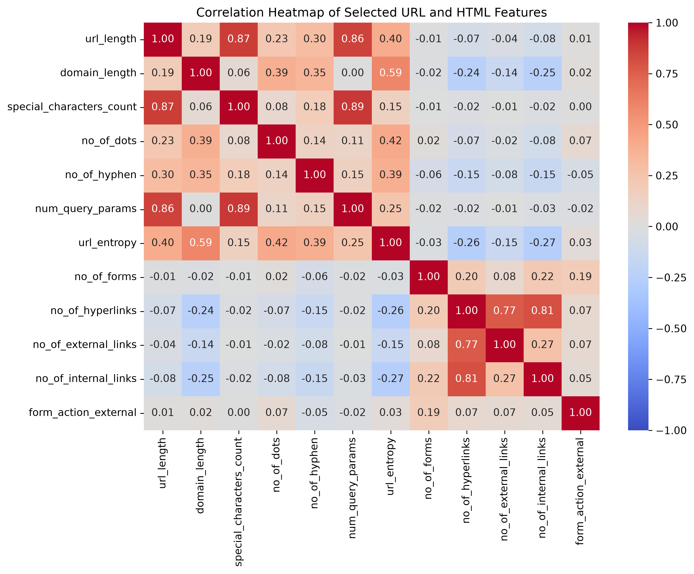
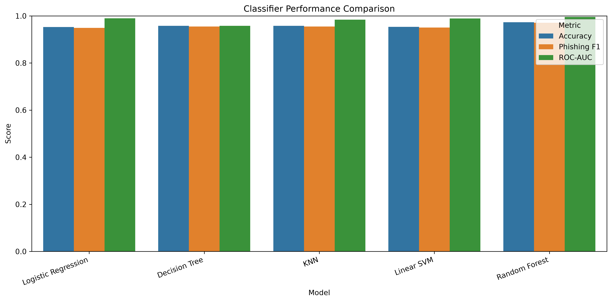
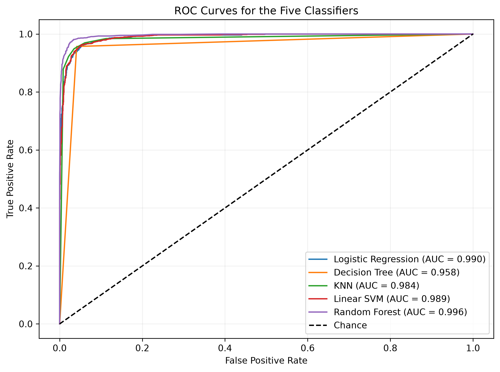
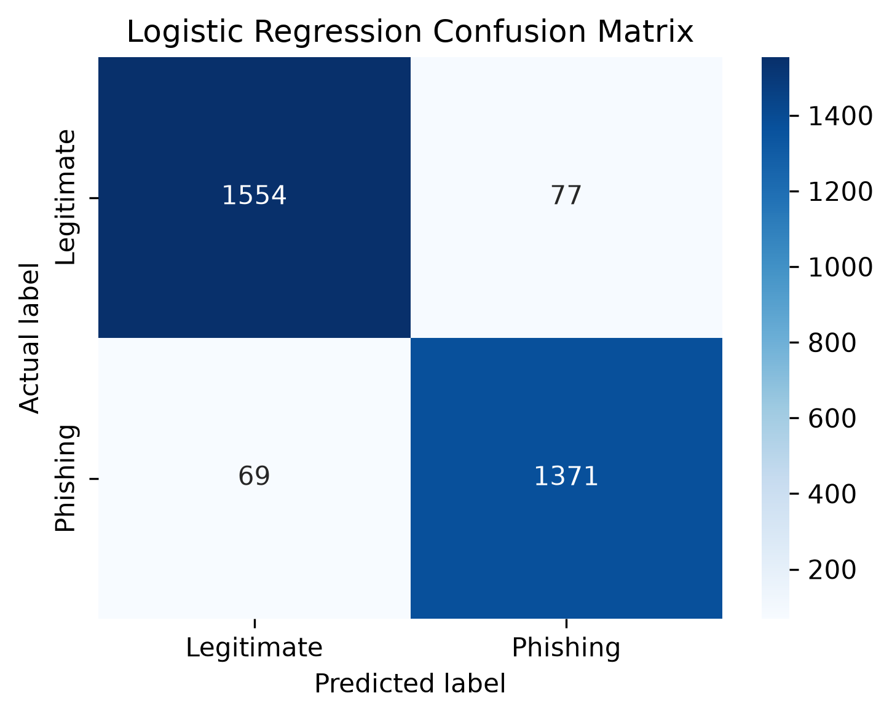
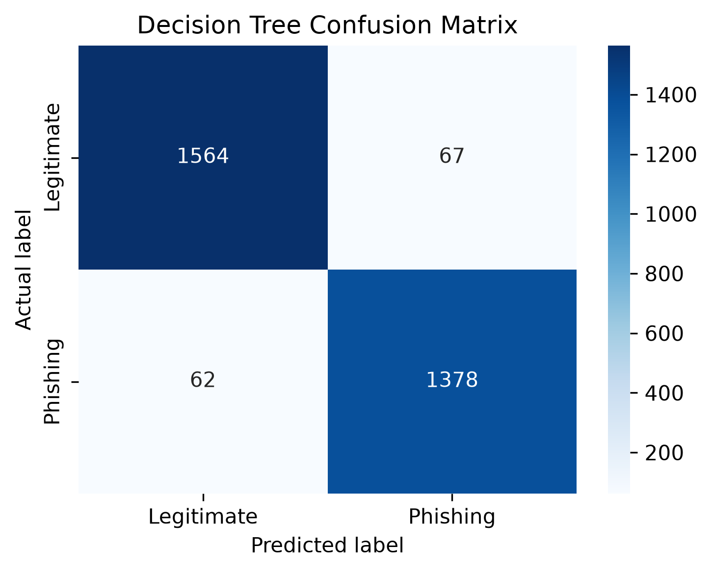
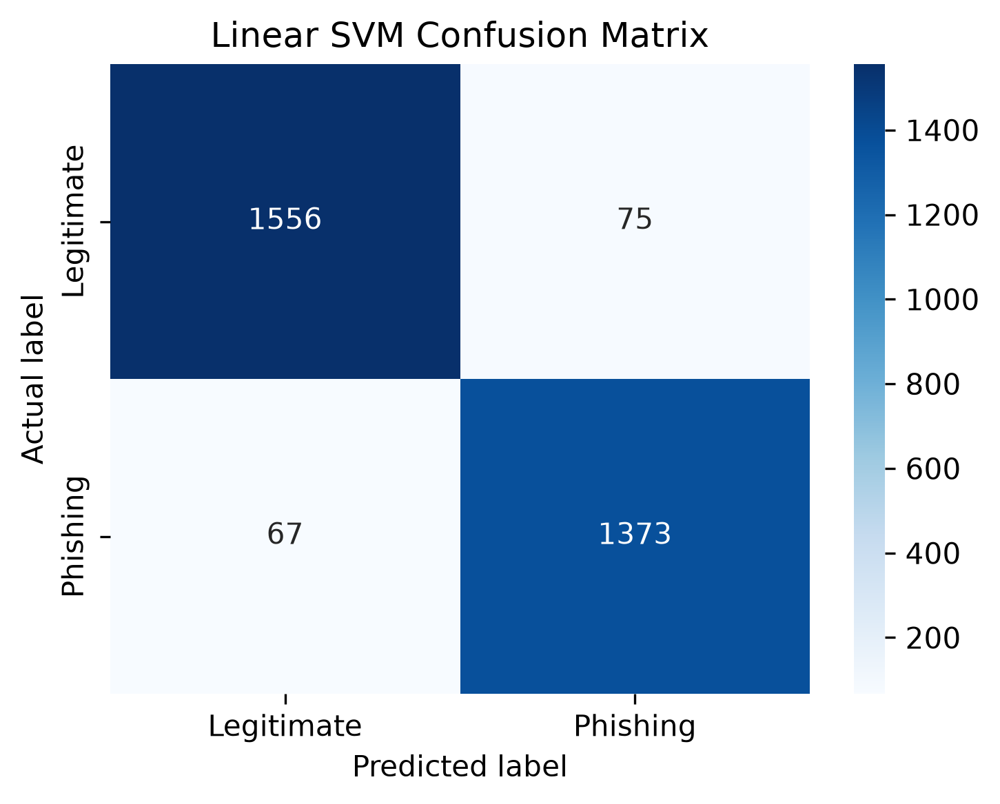
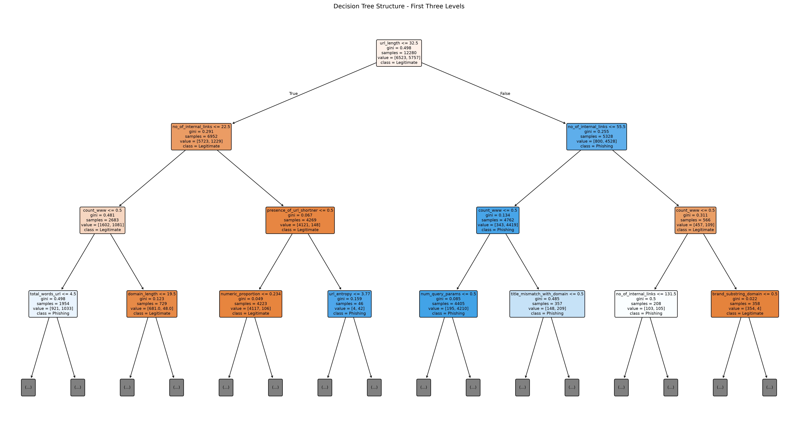
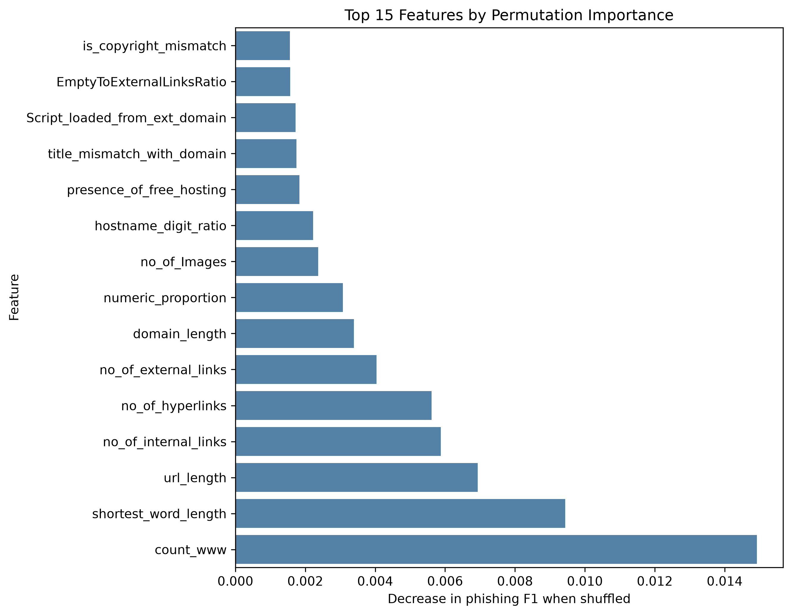
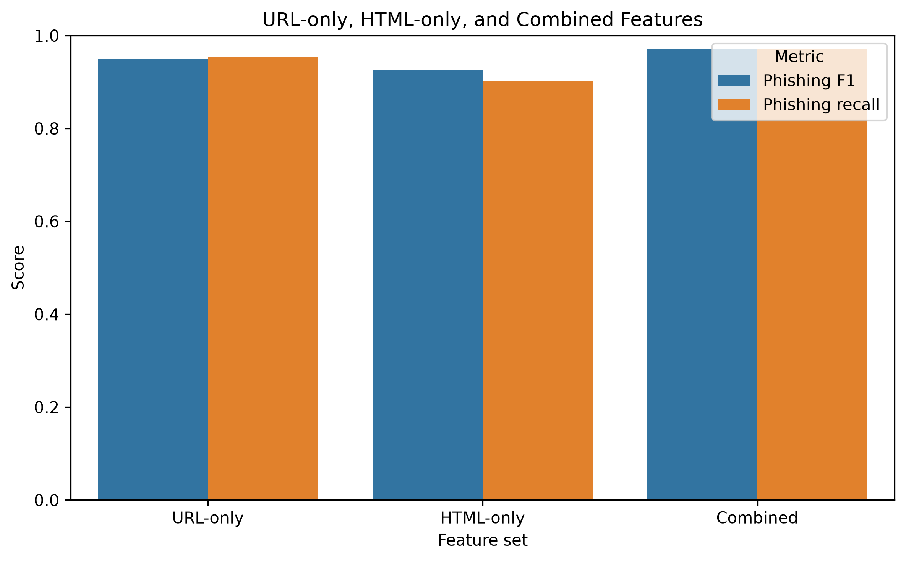

# CompPhish Phishing Website Detection

A machine learning project comparing URL-derived and HTML-derived features for phishing website detection.

## Project question

How well do URL-derived, HTML-derived, and combined features distinguish phishing websites from legitimate websites in the CompPhish dataset?

## Dataset

This project uses CompPhish Version 3. The original feature file contains 15,358 samples and 70 features, plus the URL, label, and serial number. Label `0` means legitimate and label `1` means phishing.

| Dataset check | Result |
|---|---:|
| Original samples | 15,358 |
| Legitimate samples in the original file | 8,154 |
| Phishing samples in the original file | 7,204 |
| Missing values | 0 |
| Repeated URLs removed from the analysis copy | 7 |
| Samples after repeated-URL handling | 15,351 |

The mapping file matched all original samples, with no URL or label mismatches. The analysis kept one row per repeated URL.

### Features used

The constant `brand_subdomain` feature was excluded. The data dictionary describes `url_more_than_mean` and `domain_more_than_mean` using mean lengths from phishing examples. Because these precomputed features may use information from the phishing class, they were excluded as a precaution. This project did not independently verify whether their means were calculated using training data only.

| Feature group | Features in dictionary | Features used in models |
|---|---:|---:|
| URL-based and brand-jacking | 47 | 44 |
| HTML-derived content | 23 | 23 |
| Combined | 70 | 67 |

The downloaded Excel files are not included in this repository. Download the feature spreadsheet, mapping file, and data dictionary from the [CompPhish Mendeley record](https://data.mendeley.com/datasets/fmbs4kp9wz/3) and place them in the local `data` folder.

## Method

The primary experiment used an 80/20 stratified train/test split with `random_state=42`. All five classifiers used the same split and the 67-feature set described above. Phishing, label `1`, is the positive class.

The classifiers compared were:

- Logistic Regression
- Decision Tree
- K-Nearest Neighbors (KNN)
- Linear Support Vector Machine (SVM)
- Random Forest

Features were scaled inside a pipeline for Logistic Regression, KNN, and SVM. Decision Tree and Random Forest were trained without scaling.

Metrics include accuracy, phishing precision, phishing recall, phishing F1, ROC-AUC, and confusion matrices.

### Classifier results

| Model | Accuracy | Phishing precision | Phishing recall | Phishing F1 | ROC-AUC |
|---|---:|---:|---:|---:|---:|
| Logistic Regression | 0.9525 | 0.9468 | 0.9521 | 0.9494 | 0.9896 |
| Decision Tree | 0.9580 | 0.9536 | 0.9569 | 0.9553 | 0.9579 |
| KNN | 0.9577 | 0.9600 | 0.9493 | 0.9546 | 0.9837 |
| Linear SVM | 0.9538 | 0.9482 | 0.9535 | 0.9508 | 0.9893 |
| Random Forest | 0.9730 | 0.9709 | 0.9715 | 0.9712 | 0.9959 |

Random Forest had the highest phishing F1 and ROC-AUC on this split. Its confusion matrix contained 41 false negatives and 42 false positives.

### URL-only, HTML-only, and combined features

Random Forest was evaluated on the same train/test samples for each feature set.

| Feature set | Features | Accuracy | Phishing precision | Phishing recall | Phishing F1 | ROC-AUC | False negatives | False positives |
|---|---:|---:|---:|---:|---:|---:|---:|---:|
| URL-only | 44 | 0.9525 | 0.9456 | 0.9535 | 0.9495 | 0.9878 | 67 | 79 |
| HTML-only | 23 | 0.9319 | 0.9509 | 0.9014 | 0.9255 | 0.9823 | 142 | 67 |
| Combined | 67 | 0.9730 | 0.9709 | 0.9715 | 0.9712 | 0.9959 | 41 | 42 |

Combined features performed best overall. URL-only features had higher accuracy, recall, and F1 than HTML-only features. HTML-only features had higher precision than URL-only features, but missed more phishing samples.

## Statistical analysis of URL length

The mean URL length was 52.19 characters for phishing samples and 29.35 characters for legitimate samples. Welch's two-sample t-test returned a t-statistic of 22.05 and a p-value of approximately `6.80 × 10⁻¹⁰⁶`.

A very long legitimate URL was present, so the means should be interpreted alongside the medians: 42 characters for phishing and 24 for legitimate samples.

## False negatives

The corrected Random Forest missed 41 phishing samples on the primary test split. Their average feature values compared with all phishing test samples were:

| Feature | All phishing test samples | Missed phishing samples |
|---|---:|---:|
| `count_www` | 0.05 | 0.22 |
| `shortest_word_length` | 1.09 | 0.17 |
| `url_length` | 53.23 | 27.24 |
| `no_of_hyperlinks` | 24.06 | 103.02 |
| `no_of_external_links` | 14.45 | 48.76 |
| `uses_https` | 0.79 | 0.71 |
| `brand_typo_dom` | 0.02 | 0.05 |

These are descriptive averages, not proof of why the model missed individual sites.

## Feature importance

Permutation importance ranked these features highest for the corrected Random Forest:

| Feature | Importance |
|---|---:|
| `shortest_word_length` | 0.011390 |
| `count_www` | 0.009027 |
| `no_of_hyperlinks` | 0.008007 |
| `no_of_internal_links` | 0.006998 |
| `domain_length` | 0.005764 |

Importance describes how shuffling a feature affected phishing F1 on this test set; it does not show that the feature causes phishing.

## Hostname-based evaluation

A separate stratified group split kept each hostname entirely in either training or test data. The corrected split used 67 features and had no hostname overlap: 12,281 training samples and 3,070 test samples.

| Metric | Hostname-based Random Forest |
|---|---:|
| Accuracy | 0.9687 |
| Phishing precision | 0.9647 |
| Phishing recall | 0.9687 |
| Phishing F1 | 0.9667 |
| False negatives | 45 |
| False positives | 51 |

This is a hostname-based evaluation. Different subdomains may still be treated as separate hosts, and its test samples differ from those in the random split.

## Figures

### Correlation heatmap

### Classifier comparison

### ROC curves

### Individual confusion matrices

### Logistic Regression confusion matrix

### Decision Tree confusion matrix

### KNN confusion matrix

### Linear SVM confusion matrix

### Decision Tree visualization

### Random Forest feature importance

### Feature-group comparison

## Run the project

1. Download these three Excel files from the [CompPhish Mendeley record](https://data.mendeley.com/datasets/fmbs4kp9wz/3):
   - `All_Features_threshold90.xlsx`
   - `Mapping_File.xlsx`
   - `Data_Dictionary.xlsx`
2. Place them in the local `data` folder. The files are ignored by Git and are not included in this repository.
3. Create a virtual environment and install the packages listed in `requirements.txt`.
4. Start Jupyter Notebook, open `notebooks/phishing_detection.ipynb`, and run the cells from top to bottom.

## Limitations

Phishing and legitimate samples came from different collection sources: phishing URLs were collected from PhishTank and OpenPhish, while legitimate URLs came from the DataForSEO Top-1000 websites list. These sources may introduce source-specific patterns. The dataset reflects a defined collection period and may not represent future attacks, all regions, or all languages.

The random split may include related hosts in both sets. The hostname-based split reduces exact-host overlap but does not ensure every subdomain under a registered domain stays together. Performance on CompPhish does not guarantee performance on other datasets or future websites.

## Sources

- Goenka, R. (2026). *CompPhish*, Mendeley Data, Version 3. [https://doi.org/10.17632/fmbs4kp9wz.3](https://doi.org/10.17632/fmbs4kp9wz.3). Licence: CC BY 4.0.
- Goenka, R., Chawla, M., & Tiwari, N. (2026). “CompPhish: A comprehensive dataset for diversified phishing detection.” *Data in Brief*, 69, 113219. [https://doi.org/10.1016/j.dib.2026.113219](https://doi.org/10.1016/j.dib.2026.113219).

